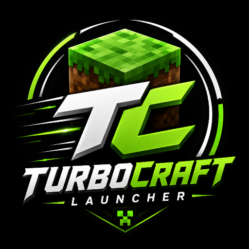

<div align="center">
  
  <h1>TurboCraft Launcher — PC Edition</h1>
  <p><strong>Official Desktop Minecraft: Java Edition Launcher for Windows, Linux &amp; macOS</strong></p>
  <p>1:1 Visual &amp; Feature Counterpart to <a href="https://github.com/TCL-Team/TurboCraft-Launcher">TCL-Team/TurboCraft-Launcher</a> (v1.6)</p>
</div>

---

## Overview

**TurboCraft Launcher — PC Edition** brings the exact glassmorphic Material-3 Expressive design, official assets, animations, and cross-platform social ecosystem of the Android **TurboCraft Launcher** natively to desktop PCs (`Windows x64/ARM64`, `Linux AppImage/.deb`, `macOS Universal`).

---

## Complete Feature Matrix

| Category | Included in PC Edition |
|---|---|
| **Visuals & UI Shell** | Exact 3-Column Home Dashboard (`Collapsible SideBar` + `Changelogs & Performance Center` + `Right Launch Dock`), frameless custom TopBar, bundled `default_background.mp4` video background, `BackgroundGlass` blur/opacity sliders, custom Minecraft cursors, and 60 FPS `FestivalCanvas` particle effects (`Fireflies`, `Snow`, `Rain`, `Interactive Fireworks`, `Hearts`, `Bats`). |
| **7 Official Material-3 Themes** | `Verdant Dawn` (`#8BE51B` default), `Embermire` (`#FE7A52`), `Velvet Rose` (`#FF80A5`), `Mistwave` (`#60C8D4`), `Glacier` (`#6FB5FF`), `Verdantfield` (`#A6D95A`), `Urban Ash` (`#9AA5B1`) + Custom Hex Palette Generator + Dark/Light Mode + Bilingual (`English` / `हिन्दी`). |
| **Accounts & 3D Skin/Cape Studio** | Official Microsoft OAuth Device-Code Xbox Live / Minecraft authentication, Offline accounts, Custom Yggdrasil Auth Server login, interactive WebGL 3D `skinview3d` character model (cursor gaze tracking, walk/run/idle/wave, tap reactions, Slim/Classic toggle, local PNG upload, Mojang username skin importer) + **15-Cape Procedural Gallery** & custom cape equipper. |
| **PC Minecraft Launch Engine** | Real Mojang Version Manifest v2 installer, parallel SHA-1 verified library/asset/client JAR downloader, OS native extraction, classpath & JVM argument resolver, live stdout/stderr console streaming, and process lifecycle tracking. |
| **MultiRT Java Manager** | Auto-detects PC JDK/JRE installations (`JAVA_HOME`, Adoptium, Oracle, Zulu, BellSoft, Linux/macOS JVMs) + **1-Click Adoptium Temurin Java 8 / 17 / 21 / 25 Auto-Downloader**. |
| **7-Tab Download Hub** | Install Vanilla + **Fabric, Quilt, Forge, NeoForge, OptiFine & LiteLoader**; browse & 1-click install **Modpacks (`.mrpack`), Mods, Resource Packs, Worlds & Shader Packs** directly from Modrinth (and optional CurseForge API) with version/loader filters & Favorites. |
| **Instance & Modpack Manager** | Isolated or shared instances, per-instance RAM/JVM flags, Mods enable/disable `.disabled` toggle, Resource Packs, Shaders, Saves, `servers.dat` NBT quick-connect editor, `.mrpack` modpack importer, and `.zip` instance backup exporter. |
| **Cross-Platform Social Hub** | Connected to the live **TurboCraft Supabase Social Network** — claim `@handle`, set/restore **Recovery Code**, Online/Idle/Offline presence, Direct Messages (send/edit/delete), **Multiplayer Parties** (host/invite/6-char code/public discovery/party chat), Reconnect button, and copyable **Connection Details** self-check diagnostics. Players on PC & Android chat and party together seamlessly! |
| **Terracotta LAN Relay & Discord RPC** | Built-in LAN TCP tunnel (`Host Room` / `Join Room` with copyable room codes & logs), Desktop **Discord Rich Presence** over native IPC, **Smart Crash Analyzer** (EN/HI) + 1-click **`mclo.gs`** log sharing, Playtime Analytics, Custom Markdown Home Editor, and Built-in File Manager. |

---

## Central Configuration (`gradle.properties`)

Just like the Android edition (`TCL/gradle.properties`), **every branding, versioning, URL, API key, and default preset** is controlled from the single root **`gradle.properties`** file:

```properties
launcher_name=TurboCraft Launcher
launcher_app_name=TurboCraft Launcher — PC Edition
launcher_short_name=TCL
launcher_app_id=com.tcl.mc.pc
launcher_version_code=9
launcher_version_name=1.6.0
url_home=https://github.com/TCL-Team/TurboCraft-Launcher-PC-Edition
url_discord=https://discord.gg/bwkpJZB6NS
oauth_client_id=00000000402b5328
#curseforge_api_key=xxx
#discord_app_id=xxx
default_theme=VERDANT_DAWN
default_ram_mb=4096
```

Whenever you run `npm run dev`, `npm run build`, `npm run dist:*` (or edit `gradle.properties` live during `npm run dev`), `scripts/syncProperties.mjs` automatically updates `BuildKeys` (`src/generated/buildConfig.ts`), `package.json`, `electron-builder.json`, `index.html`, Electron window/tray titles, JVM `-Dminecraft.launcher.brand`, Terracotta room prefixes, and community links.

---

## Quick Start (Development)

```bash
# 1. Install dependencies
npm install

# 2. Run Web UI + PC Core API Server (Browser Preview Mode)
npm run dev:web
npm run dev:api

# 3. Or launch full frameless Electron Desktop Window
npm run dev:electron
```

## Build Desktop Installers

```bash
# Typecheck + Production Bundle
npm run typecheck
npm run build

# Package OS-specific installers into ./release/
npm run dist:win     # Windows NSIS Setup (.exe) + Portable (.exe)
npm run dist:linux   # Linux AppImage + Debian (.deb)
npm run dist:mac     # macOS (.dmg + .zip)
```

---

## Community & Credits

- **Discord**: [https://discord.gg/bwkpJZB6NS](https://discord.gg/bwkpJZB6NS)
- **YouTube**: [https://youtube.com/@TurboCraft_Launcher](https://youtube.com/@TurboCraft_Launcher)
- **GitHub Organization**: [https://github.com/TCL-Team](https://github.com/TCL-Team)
- **License**: GNU General Public License v3.0 (`GPL-3.0`)
